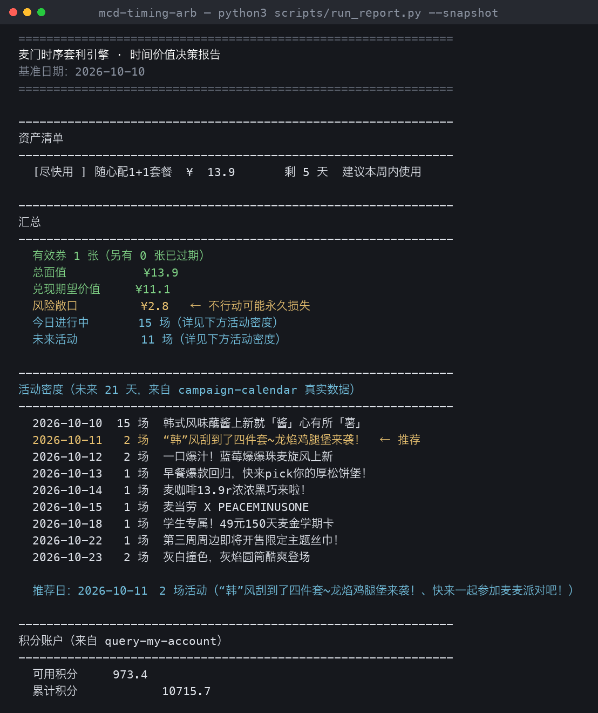

# 麦门时序套利引擎

> 你的券在悄悄过期。麦门时序套利引擎把麦当劳 MCP 返回的券、活动日历、
> 积分和商城数据，量化成一张「今天该动还是该等」的行动日历。

<p align="center">
  <a href="https://github.com/kequeen/mcd-timing-arb/stargazers">
    
  </a>
  <a href="https://github.com/kequeen/mcd-timing-arb/network/members">
    
  </a>
</p>

**如果这个项目对你有用，欢迎点一颗 Star ⭐️** —— 本项目正参加麦当劳程序员创意开发大赛，
公开 Star 数是唯一的排名依据，这颗 Star 会直接决定它能否进入排行榜。

## 效果预览

下面是**真实数据运行结果**（2026-10-10 采集，快照见 `fixtures/real-snapshot.json`）：



一句话读懂：**它把「你还有多少钱」换算成了「你今天该不该花」**——
¥13.9 的券 5 天后归零，引擎算出它现在的兑现期望价值只有 ¥11.1，
并指出当天 15 场活动全是进行中的噪声，真正值得下单的是**次日**。

完整输出（含积分账户与最佳行动日推导）见 [三、使用示例](#三使用示例)。

---

## 一、它解决什么问题

你手上有麦当劳的券，但**没人告诉你什么时候用最划算**。

现实中的三种浪费：

| 浪费形态 | 真实场景 | 本引擎的处理 |
|---|---|---|
| **归零** | 券到期没想起来用，¥45 直接变0 | 标出「今日必用」，并在最佳行动日聚合提醒 |
| **错峰** | 明明今天有买赠活动，却等到券快过期才下单 | 计算活动增益叠加，给出具体行动日期 |
| **遗漏** | 有一张深埋账号里没人用的券，从没被翻出来 | 全量拉取并计算风险敞口 |

核心洞察是：**券不是慢慢贬值的，它是悬崖式归零。**
今天值 ¥45，明天值 ¥0。所以本引擎建模的是「这张券最终能不能真的被用掉」
的概率，而不是「它现在还剩多少价值」——这决定了它给出的建议是
「今天必须用」还是「本月内随意」。

## 二、核心概念：两个方向相反的指标

引擎刻意区分两个独立的量，避免把提醒强度和金额混为一谈：

| 指标 | 回答的问题 | 随剩余天数变化 | 用途 |
|---|---|---|---|
| **过期压力** `urgency` | 现在要不要动？ | 越近越大，指数增长 | 只用于**排序提醒强度** |
| **兑现概率** `decay` | 这钱能不能留住？ | 越远越大，单调饱和 | 用于**计算风险敞口** |

```
今日到期压力 = 1.00    一周后 ≈ 0.37     ≥21 天 = 0.00
今日兑现概率 = 0.68    一周后 ≈ 0.83     远期 ≈ 0.93（永不为1）
```

**风险敞口** = 面值 × (1 − 兑现概率)，即「现在不用就真会亏掉的钱」，
这是整个引擎的驱动量。

## 三、快速开始

### 前置条件

1. 已申请麦当劳 MCP Token（见下方链接）
2. 已将 MCP 配置到 WorkBuddy（见下方链接）
3. Python 3.10+（仅运行分析脚本需要，纯标准库无依赖）

### 安装与配置

```bash
git clone https://github.com/kequeen/mcd-timing-arb.git
cd mcd-timing-arb
```

在 WorkBuddy 左侧边栏【专家·技能·连接器】→【连接器】→
【自定义连接器】→【配置MCP】，填入：

```json
{
  "mcpServers": {
    "mcd-mcp": {
      "type": "streamablehttp",
      "url": "https://mcp.mcd.cn",
      "headers": {
        "Authorization": "Bearer YOUR_MCP_TOKEN"
      }
    }
  }
}
```

保存后启用 `mcd-mcp`。仓库内的 `mcp-config.example.json`
只含环境变量占位符，可安全提交。

- MCP Token 申请：<https://open.mcd.cn/mcp>
- WorkBuddy 连接器文档：<https://www.workbuddy.cn/docs/workbuddy/From-Beginner-to-Expert-Guide/Function-Description/Connector>

### 使用示例

以下输出为**真实数据运行结果**（2026-10-10 采集，快照见 `fixtures/real-snapshot.json`）：

```
共 1 张有效券，总面值 ¥13.9，其中 ¥0 今日到期

[尽快用] 随心配1+1套餐    ¥13.9   剩 5 天  建议本周内使用

活动密度（未来 21 天，来自 campaign-calendar 真实数据）
  2026-10-10  15 场  韩式风味蘸酱上新
  2026-10-11   2 场  「韩」风刮到了四件套~龙焰鸡腿堡来袭！  ← 推荐
  2026-10-12   2 场  蓝莓爆爆珠麦旋风上新
  2026-10-13   1 场  早餐爆款回归，快来pick你的厚松饼堡
  ...
  2026-10-23   2 场  灰焰圆筒酷爽登场

积分账户（来自 query-my-account）
  可用积分     973.4
  本月将过期      36.8   ← 不换掉就归零

最佳行动日：2026-10-11（周日）
  依据：活动密度（campaign-calendar 真实数据）
```

**为什么推荐 10-11 而不是今天？** 今天虽有 15 场活动，
但接口把所有进行中的活动都挂在今天，直接取最大密度会永远得出「今天」，
择时失效。因此引擎只在 `今天+1 ~ 今天+21` 范围内比较密度。

### 三个时间维度

| 维度 | 数据来源 | 损失性质 |
|---|---|---|
| **优惠券** | `query-my-coupons` | 这张券作废 |
| **活动密度** | `campaign-calendar` | 机会成本（非直接损失） |
| **积分** | `query-my-account` | 这笔余额归零 |

券过期是「这张券作废」，积分过期是「这笔余额归零」——
两者处置时机不同，本引擎分别建模，不混算。

## 四、离线运行（无需 Token）

算法核心是纯函数，可直接用离线样例数据验证：

```bash
python3 scripts/run_report.py --demo                # 人工构造样例
python3 scripts/run_report.py \
  --snapshot fixtures/real-snapshot.json           # 真实 API 快照
```

`fixtures/real-snapshot.json` 是从 `mcp.mcd.cn` v1.0.0 采集的真实响应，
已脱敏（移除图片签名 URL 与 Token）。它的价值在于：
**确保字段适配不会退化**——真实 API 与文档推测存在四处关键差异，
详见 `MCP_INTEGRATION.md` 第四节。

## 五、目标用户

- **持有多张麦当劳券但从不主动查看的人** —— 本引擎替代「凭记忆办事」
- **偏好「活动日下单比平时划算」的用户** —— 提供可执行的具体日期
- **积分余额长期闲置的用户** —— 揭示积分过期与兑换窗口

## 六、项目结构

```
mcd-timing-arb/
├── README.md                    本文件
├── CONTEST_DECLARATION.md       参赛声明（官方原文，不可修改）
├── MCP_INTEGRATION.md           MCP 工具与调用流程说明
├── mcp-config.example.json      脱敏配置示例
├── SKILL.md                     Skill 定义与指令
├── workbuddy.md                 WorkBuddy 开发上下文记录
├── docs/
│   └── demo-terminal.png        真实运行输出截图（README 首屏）
├── .github/
│   └── social-preview.png       仓库社交预览图（链接展开卡片）
├── scripts/
│   ├── arb_core.py              时间价值评分核心（纯函数，无依赖）
│   ├── run_report.py            命令行报告生成
│   ├── make_demo_shot.py        生成 README 首屏截图
│   ├── make_social_card.py      生成社交预览图
│   └── test_arb_core.py         自测套件（114 项断言）
├── references/
│   ├── scoring-model.md         评分模型完整推导
│   └── mcp-tools.md             MCP 工具清单与真实字段映射
└── fixtures/
    ├── demo-snapshot.json       人工构造的离线样例
    └── real-snapshot.json       真实 API 快照（已脱敏）
```

## 七、测试

```bash
python3 scripts/test_arb_core.py
```

采用**固定基准日期**（2026-10-10），结果完全可复现。114 项断言分三组：

**模型自洽性**——兑现概率与压力的方向正确性、单调性、
压力曲线形状（防视野坍缩）、最佳行动日不被高增益活动迷惑、
平票处理、过期过滤、空数据边界、幂等性。

**真实API 适配**（第 14 组）——直接用真实响应结构做断言，
锁定分/元单位换算、`tradeEndDate` 解析、`articleDto.title` 活动名提取、
`dailyList` 三层嵌套、字符串型积分字段。这是防退化最关键的一组。

**零值与边界**（第 15~18 组）——活动密度不得凌驾于券的寿命、
多日活动区间不被退化为单日、`0` 不被误判为缺失、
建议文案不重复剩余天数。

### 开发过程中被自测拦下的真实缺陷

全部已固化为回归测试：

1. **衰减语义错误** —— 把「券是悬崖式归零」误建模为「价值线性折损」，
   导致¥45 的券今天只值 ¥5.4
2. **最佳行动日被活动增益迷惑** —— 会推荐「放弃 ¥45 临期券换 +¥22 活动」
   的净亏损日期
3. **压力曲线视野坍缩** —— λ 取值过大导致「本周内」档位被压没
4. **已过期券仍被提醒「需更早使用」** —— 已是无法挽回的事
5. **面额单位混用** —— `denomination`（分）被当元读，夸大 100 倍
6. **面额解析失败** —— 字段名不符导致所有券面额读成 ¥0
7. **多日活动退化为单日** —— 扁平结构的 endTime 被丢弃
8. **活动密度被「今日」污染** —— 15 场 vs 未来 1~2 场，择时永久失效
9. **建议文案重复剩余天数** —— advice 自带「剩 N 天」，
   与报告的剩余天数列并排显示成「剩5 天 剩 5 天，建议本周内使用」

## 八、隐私与合规

- Token 只存在于本地 MCP 配置，**绝不写入仓库**，仓库内仅有 `${MCD_MCP_TOKEN}` 占位符
- 引擎只读取券/活动/积分信息，**不涉及下单支付**，不代替你确认任何订单
- 风险敞口与行动建议为算法估算，不构成投资或消费建议
- 输出仅供参考，餐品价格与供应状态以麦当劳官方渠道实时结果为准

本项目为麦当劳程序员节创意开发大赛参赛作品，由参赛者独立开发，
非麦当劳官方产品，与麦当劳及其关联方无任何隶属或背书关系。